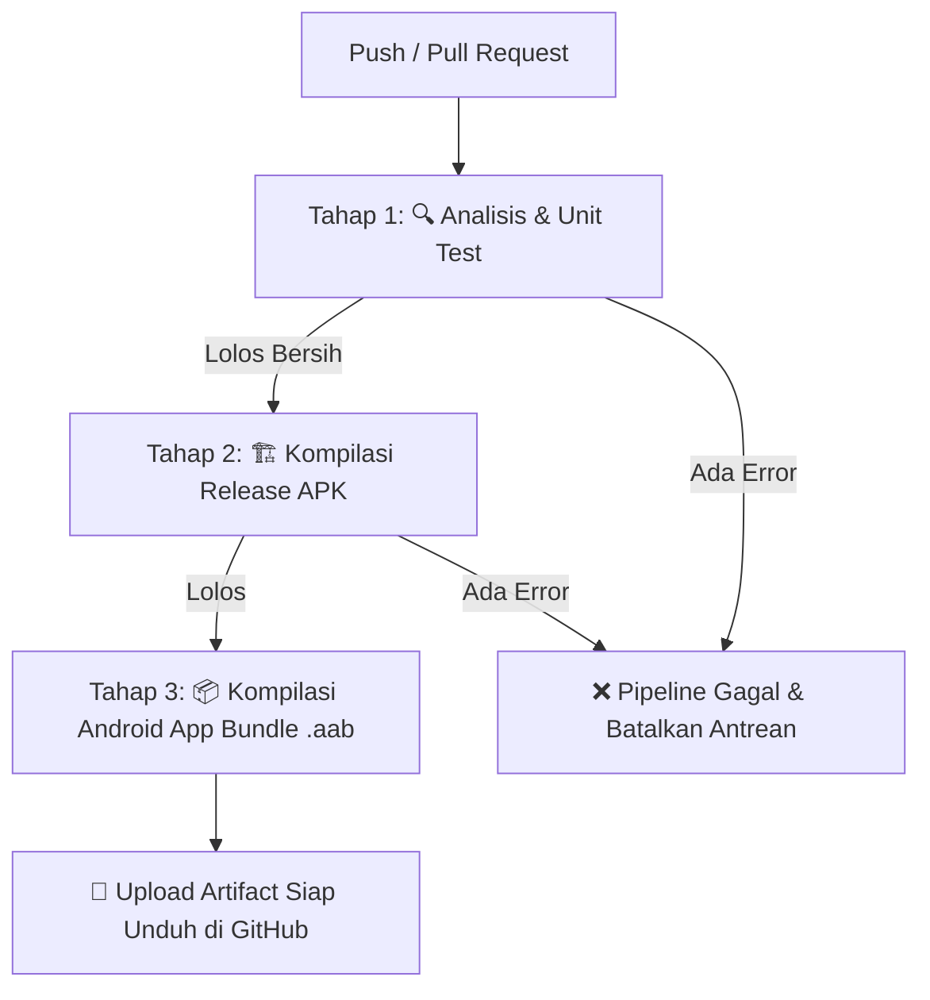

# 🚀 Panduan Otomasi CI/CD GitHub Actions untuk Flutter Mobile

Halo tim Nootid! Di dokumen ini kita mengupas tuntas arsitektur pipeline otomatisasi pengujian kode dan pembuatan file instalasi Android (APK & AAB) menggunakan **GitHub Actions**.

Dengan pipeline ini, setiap kali ada kode baru yang di-push atau di-merge ke branch `staging` atau `main`, robot cloud akan secara otomatis menjalankan pengujian kode dan mengompilasi biner Android siap uji tanpa membebani laptop developer.

---

## 1. Alur Kerja 3 Tahap Pipeline Mobile



1. **Tahap 1 (`analyze-and-test`)**: Menjalankan pengecekan format dan sintaks (`flutter analyze`) serta pengujian otomatis logic bisnis (`flutter test`).
2. **Tahap 2 (`build-apk`)**: Mengompilasi `app-release.apk` agar tim penguji PKM-KC bisa langsung mengunduh dan menginstal aplikasi di smartphone masing-masing.
3. **Tahap 3 (`build-appbundle`)**: Mengompilasi `app-release.aab` berukuran ringkas untuk kebutuhan rilis resmi ke **Google Play Console**.

---

## 2. Fitur Efisiensi Runner: Pembatalan Antrean Otomatis (`concurrency`)

```yaml
concurrency:
  group: ${{ github.workflow }}-${{ github.ref }}
  cancel-in-progress: true
```

* **Manfaat**: Bila tim melakukan push beruntun dalam hitungan menit, GitHub Actions otomatis **membatalkan eksekusi commit lama** dan langsung memprioritaskan commit terbaru. Ini menghemat kuota menit runner cloud gratisan GitHub!

---

## 3. Template Lengkap `.github/workflows/flutter-ci-cd.yml`

```yaml
name: Flutter CI/CD Pipeline

on:
  push:
    branches:
      - main
      - staging
  pull_request:
    branches:
      - main
      - staging
  workflow_dispatch:

concurrency:
  group: ${{ github.workflow }}-${{ github.ref }}
  cancel-in-progress: true

jobs:
  test:
    name: 🔍 Test & Quality Check
    runs-on: ubuntu-latest
    steps:
      - name: 📥 Checkout Repository
        uses: actions/checkout@v4

      - name: ☕ Setup Java (JDK 17)
        uses: actions/setup-java@v4
        with:
          distribution: 'zulu'
          java-version: '17'

      - name: 💙 Setup Flutter Environment
        uses: subosito/flutter-action@v2
        with:
          flutter-version: '3.24.x'
          channel: 'stable'
          cache: true

      - name: 📦 Install Dependencies
        run: flutter pub get

      - name: 🔎 Static Analysis
        run: flutter analyze

      - name: 🧪 Run Unit & Widget Tests
        run: flutter test

  build-android:
    name: 🏗️ Build Android Release Artifacts
    needs: test
    runs-on: ubuntu-latest
    if: github.ref == 'refs/heads/main' || github.ref == 'refs/heads/staging'
    steps:
      - name: 📥 Checkout Repository
        uses: actions/checkout@v4

      - name: ☕ Setup Java (JDK 17)
        uses: actions/setup-java@v4
        with:
          distribution: 'zulu'
          java-version: '17'

      - name: 💙 Setup Flutter
        uses: subosito/flutter-action@v2
        with:
          flutter-version: '3.24.x'
          channel: 'stable'
          cache: true

      - name: 📦 Install Dependencies
        run: flutter pub get

      - name: 📱 Build Release APK (Untuk Pengujian Tim)
        run: flutter build apk --release

      - name: 📦 Build Android App Bundle (Untuk Google Play Store)
        run: flutter build appbundle --release

      - name: 📤 Upload APK ke Artifact GitHub
        uses: actions/upload-artifact@v4
        with:
          name: nootid-release-apk
          path: build/app/outputs/flutter-apk/app-release.apk

      - name: 📤 Upload AAB ke Artifact GitHub
        uses: actions/upload-artifact@v4
        with:
          name: nootid-release-bundle
          path: build/app/outputs/bundle/release/app-release.aab
```
